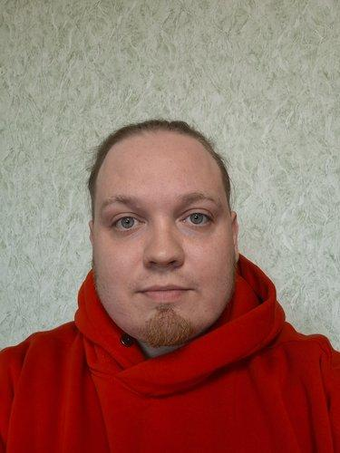

# Семенов Владислав

Мужчина, 30 лет, родился 6 июня 1996

## Желаемая должность и зарплата

> Тестировщик  
Специализации:  
— Тестировщик мобильных приложений   
Тип занятости: полная занятость  
Формат работы: на месте работодателя, удалённо  
Желательное время в пути до работы: не более часа

## Опыт работы — 8 лет 9 месяцев
### КАМИС
Специалист по внедрению и сопровождению музейных
автоматизированных информационных систем
- Занимался настройкой баз данных для музейных организаций.
- Работал с SQL-запросами и писал скрипты для обработки данных в БД.
- Осуществлял руководство проектом по сопровождению и развитию КАМИС в музеях,
подотчетных Департаменту культуры г. Москва (команда из 7 человек).
- Имел опыт регрессионного тестирования веб-приложений при внедрении новых модулей
(дополнительного функционала) в автоматизированные информационные системы, а также
смоук-тестирования КАМИС перед передачей новых релизов системы непосредственно в
музеи.
- Готовил тестовые данные в БД.
- Составлял тест-кейсы и чек-листы для тестирования новых модулей КАМИС.
- Ставил задачи на исправление багов команде разработки.